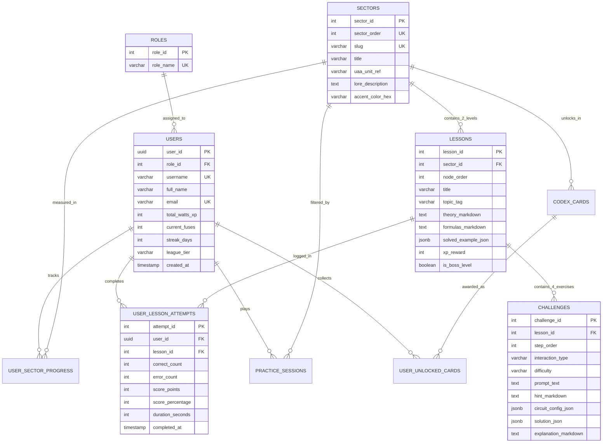

# 🗄️ OhmDrive — Data Dictionary, 3NF Database & Official Rubric JSON Specification

This document serves as the **Single Source of Truth (SSOT)** for the PostgreSQL (Supabase) 3NF relational database schema, `localStorage` persistence schema, and the **Official JSON Contract** for the **3 Units, 6 Levels, and 24 Verified Exercises** required by the professor's rubric.

---

## 1. Official Structure Required by Rubric (3 Units · 6 Levels · 24 Exercises)

| Unidad (`sector_id`) | Nivel (`lesson_id`) | Título Oficial del Nivel (Rúbrica) | `topic_tag` | Cantidad de Ejercicios |
| :--- | :--- | :--- | :--- | :--- |
| **Unidad 1:** Distrito Ohm | **Nivel 1** (`lesson_id: 1`) | **(1) Voltaje, corriente y resistencia** | `"v_i_r"` | **4 ejercicios** (2 Opción Múltiple + 2 Respuesta Numérica) |
| **Unidad 1:** Distrito Ohm | **Nivel 2** (`lesson_id: 2`) | **(2) Ley de Ohm y potencia** | `"ohm_power"` | **4 ejercicios** (2 Opción Múltiple + 2 Respuesta Numérica) |
| **Unidad 2:** Red de Distribución | **Nivel 3** (`lesson_id: 3`) | **(3) Serie y paralelo** | `"series_parallel"`| **4 ejercicios** (2 Opción Múltiple + 2 Respuesta Numérica) |
| **Unidad 2:** Red de Distribución | **Nivel 4** (`lesson_id: 4`) | **(4) Divisores de voltaje y corriente** | `"dividers"` | **4 ejercicios** (2 Opción Múltiple + 2 Respuesta Numérica) |
| **Unidad 3:** Núcleo Kirchhoff | **Nivel 5** (`lesson_id: 5`) | **(5) Leyes de Kirchhoff** | `"kirchhoff"` | **4 ejercicios** (2 Opción Múltiple + 2 Respuesta Numérica) |
| **Unidad 3:** Núcleo Kirchhoff | **Nivel 6** (`lesson_id: 6`) | **(6) Introducción a nodos y mallas** | `"nodes_meshes"` | **4 ejercicios** (2 Opción Múltiple + 2 Respuesta Numérica) |
| **TOTAL OFICIAL** | **6 Niveles** | **Corriente Directa (CD)** | — | **24 Ejercicios Verificados** |

---

## 2. Relational Schema Overview (PostgreSQL 3NF)

* **RDBMS:** PostgreSQL 15 (Supabase)
* **Normalization:** 3rd Normal Form (3NF)
* **Local Persistence (Rubric Criteria 9 & 10):** Stored in `localStorage` under key `ohmdrive_local_state_v1` so the student/professor can close and reopen the browser and immediately see Completed vs Pending levels, hits, errors, and scores.



---

## 3. Standard JSON Contract for Each Level (`LessonSchema` — Rubric Criterion 3)

To fulfill **Criterion 3 (*"Presentar una explicación breve del tema, las fórmulas necesarias y un ejemplo resuelto antes de comenzar los ejercicios"*)**, every level (`lesson`) inside `src/data/sectors/` **MUST** include these fields:

```json
{
  "lesson_id": 2,
  "sector_id": 1,
  "node_order": 2,
  "title": "Nivel 2: Ley de Ohm y Potencia",
  "topic_tag": "ohm_power",
  "xp_reward": 100,
  "is_boss_level": false,
  "theory_markdown": "# ⚡ Explicación Breve: Ley de Ohm y Potencia en CD\nLa **Ley de Ohm** establece que la corriente ($I$) que circula por un conductor es directamente proporcional al voltaje aplicado ($V$) e inversamente proporcional a su resistencia ($R$). A su vez, la **potencia eléctrica ($P$)** mide la rapidez con la que la energía se absorbe o disipa en forma de calor (Efecto Joule).",
  "formulas_markdown": "### 📐 Fórmulas Necesarias\n* **Ley de Ohm:** $$V = I \\cdot R \\quad \\Longleftrightarrow \\quad I = \\frac{V}{R} \\quad \\Longleftrightarrow \\quad R = \\frac{V}{I}$$\n* **Potencia en Corriente Directa:** $$P = V \\cdot I = I^2 \\cdot R = \\frac{V^2}{R} \\quad [\\text{Watts, W}]$$",
  "solved_example_json": {
    "title": "Ejemplo Resuelto: Cálculo de Corriente y Potencia en un Resistor",
    "problem_statement": "Una fuente de corriente directa de Vs = 12 V alimenta una resistencia de R1 = 400 Ω. Calcula la corriente I que circula por el circuito y la potencia P disipada por la resistencia.",
    "circuit_config_json": {
      "template": "single_loop_dc",
      "is_energized_initially": true,
      "current_speed_amps": 0.03,
      "nodes": [
        { "id": "N1", "x": 60, "y": 60, "label": "+12V" },
        { "id": "N2", "x": 280, "y": 60, "label": "A" },
        { "id": "N3", "x": 280, "y": 180, "label": "B" },
        { "id": "N4", "x": 60, "y": 180, "label": "GND", "is_ground": true }
      ],
      "components": [
        { "id": "VS1", "type": "voltage_source_dc", "from": "N4", "to": "N1", "label": "Vs", "value": 12, "unit": "V" },
        { "id": "R1", "type": "resistor", "from": "N1", "to": "N2", "label": "R1", "value": 400, "unit": "Ω" },
        { "id": "W1", "type": "wire", "from": "N2", "to": "N3" },
        { "id": "W2", "type": "wire", "from": "N3", "to": "N4" }
      ]
    },
    "steps_markdown": "1. **Identificamos los datos:** $V_s = 12\\text{ V}$ y $R_1 = 400\\text{ }\\Omega$.\n2. **Calculamos la corriente con la Ley de Ohm:**\n$$I = \\frac{V_s}{R_1} = \\frac{12\\text{ V}}{400\\text{ }\\Omega} = 0.03\\text{ A} = 30\\text{ mA}$$\n3. **Calculamos la potencia disipada:**\n$$P = V_s \\cdot I = 12\\text{ V} \\times 0.03\\text{ A} = 0.36\\text{ W} = 360\\text{ mW}$$",
    "final_result": "I = 30 mA (0.03 A)  |  P = 0.36 W (360 mW)"
  },
  "challenges": [ ...4 ejercicios verificados... ]
}
```

---

## 4. Standard JSON Contract for the 24 Exercises (`ChallengeSchema` — Criteria 4, 5, 6, 7)

Every level **MUST contain 4 exercises** (`challenges`), combining **Multiple Choice** (`"multiple_choice"` / `"component_slot"`) and **Numeric Response with Units** (`"numeric_input"`), all featuring a `"hint_markdown"` (for the retry on first error) and `"explanation_markdown"` (for the final step-by-step solution).

### 4.1 Example of a `"numeric_input"` Exercise (With Units & Rounding Tolerance)
```json
{
  "challenge_id": "U1-L2-C03",
  "lesson_id": 2,
  "step_order": 3,
  "topic_tag": "ohm_power",
  "interaction_type": "numeric_input",
  "difficulty": "normal",
  "kilo_emotion": "thinking",
  "kilo_dialogue": "¡Tu turno de calcular con precisión! Ingresa el valor numérico y selecciona la unidad correcta.",
  "prompt_text": "En el siguiente circuito, una fuente de Vs = 24 V alimenta un resistor de R1 = 1.2 kΩ. Calcula la corriente I que circula por el lazo.",
  "hint_markdown": "💡 **Pista de K-1L0:** Recuerda convertir primero $1.2\\text{ k}\\Omega$ a Ohms ($1200\\text{ }\\Omega$) y aplicar $I = \\frac{V_s}{R_1}$. Verifica si expresas tu resultado en $\\text{A}$ o en $\\text{mA}$.",
  "circuit_config_json": {
    "template": "single_loop_dc",
    "is_energized_initially": true,
    "current_speed_amps": 0.02,
    "nodes": [
      { "id": "N1", "x": 60, "y": 60, "label": "+24V" },
      { "id": "N2", "x": 280, "y": 60, "label": "A" },
      { "id": "N3", "x": 280, "y": 180, "label": "B" },
      { "id": "N4", "x": 60, "y": 180, "label": "GND", "is_ground": true }
    ],
    "components": [
      { "id": "VS1", "type": "voltage_source_dc", "from": "N4", "to": "N1", "label": "Vs", "value": 24, "unit": "V" },
      { "id": "R1", "type": "resistor", "from": "N1", "to": "N2", "label": "R1", "value": 1200, "unit": "Ω" },
      { "id": "W1", "type": "wire", "from": "N2", "to": "N3" },
      { "id": "W2", "type": "wire", "from": "N3", "to": "N4" }
    ]
  },
  "unit_options": ["A", "mA", "V", "Ω", "W"],
  "default_unit": "mA",
  "solution_json": {
    "target_base_si_value": 0.02,
    "base_si_unit": "A",
    "display_target_value": 20,
    "display_unit": "mA",
    "accepted_units": {
      "A": 1,
      "mA": 0.001
    },
    "tolerance_percent": 3.0,
    "resulting_current_amps": 0.02,
    "resulting_power_watts": 0.48
  },
  "explanation_markdown": "### ✅ Procedimiento Correcto\n1. Convertimos la resistencia a Ohms: $R_1 = 1.2\\text{ k}\\Omega = 1,200\\text{ }\\Omega$.\n2. Aplicamos la Ley de Ohm:\n$$I = \\frac{V_s}{R_1} = \\frac{24\\text{ V}}{1200\\text{ }\\Omega} = 0.02\\text{ A} = 20\\text{ mA}$$"
}
```

### 4.2 Supported Unit Multipliers in `challengeValidator.js` (Criterion 6)
When validating `"numeric_input"`, `challengeValidator.js` converts the user's input (`userValue * unitMultiplier`) to the base SI unit and checks:
1. **Is the chosen unit valid for that physical quantity?** (e.g., if the problem asks for Current, choosing `"V"` or `"Ω"` fails with a specific unit error message: *"Revisar unidades: se solicitó corriente en A o mA"*).
2. **Is the converted SI numeric value within `tolerance_percent` (default $\pm 3\%$) of `target_base_si_value`?**
   * Consequently, typing `20` with unit `mA` ($20 \times 10^{-3} = 0.02\text{ A}$) OR typing `0.02` with unit `A` ($0.02 \times 1 = 0.02\text{ A}$) are **BOTH accepted as 100% correct**!

| Physical Quantity | Base SI Unit | Accepted Units & Multipliers |
| :--- | :--- | :--- |
| **Voltaje ($V$)** | `"V"` | `"V": 1`, `"mV": 0.001`, `"kV": 1000` |
| **Corriente ($I$)** | `"A"` | `"A": 1`, `"mA": 0.001`, `"μA": 0.000001` |
| **Resistencia ($R$)**| `"Ω"` | `"Ω": 1`, `"kΩ": 1000`, `"MΩ": 1000000` |
| **Potencia ($P$)** | `"W"` | `"W": 1`, `"mW": 0.001`, `"kW": 1000` |
| **Carga / Energía** | `"C"` / `"J"`| `"C": 1`, `"J": 1`, `"kJ": 1000` |

### 4.3 `circuit_config_json` — Component Types & Diagram Annotations (US-08R, `<CircuitCanvas />`)

`<CircuitCanvas />` draws everything from `circuit_config_json`. All fields below marked *optional* are backwards compatible: older JSONs keep working without them.

**Canvas:** `viewBox="0 0 360 240"`. Keep nodes between `x: 40–320` and `y: 50–190` so labels have room. Use horizontal/vertical segments; diagonal ones are supported but harder to read.

**Supported `components[].type`:**

| `type` | Drawn as | Direction convention (`from` → `to`) |
| :--- | :--- | :--- |
| `voltage_source_dc` | Cyan circle with `+` / `−` | `from` = negative terminal, `to` = positive terminal |
| `current_source_dc` | Amber circle with arrow | Arrow points from `from` to `to` |
| `resistor` | Magenta IEEE zig-zag | — |
| `resistor_slot` | Dashed tappable box (`component_slot` exercises) | — |
| `wire` | Copper trace (no label) | — |
| `cyber_led` | Diode symbol, glows green when energized | Anode = `from`, cathode = `to` |
| `cyber_sensor` | Series meter with digital display (`value: null` → `"? A"`) | — |

Unknown types render as a generic dashed box (the screen never crashes).

**Optional per-component field — `current_amps` (number):** real current of that branch. It sets the speed of that branch's electron-flow animation (parallel branches move at different speeds) and its direction: positive = flows `from` → `to`, negative = flows `to` → `from`, `0` = no flow. Without it, every branch uses `current_speed_amps`.

**Optional `annotations` array (Levels 4–6):**

| Annotation | Fields | Drawn as |
| :--- | :--- | :--- |
| `current_arrow` | `target` (component id), `label` (e.g. `"I₁"`, `"I_x = ?"`), `reverse` (bool, optional) | Amber arrowhead on the branch + label. Follows the sign of the target's `current_amps`. |
| `node_voltage` | `node` (node id), `label` (e.g. `"V_A = ?"`) | Cyan ring on the node + pill tag |
| `mesh_current` | `label` (e.g. `"I_a"`), `nodes` (ids of the mesh corners) **or** `center` `{x, y}`, `clockwise` (default `true`), `radius` (default `22`) | Dashed circular arrow in the middle of the mesh |

```json
"annotations": [
  { "type": "node_voltage", "node": "A", "label": "V_A = ?" },
  { "type": "current_arrow", "target": "R1", "label": "I₁" },
  { "type": "current_arrow", "target": "R3", "label": "I₃" },
  { "type": "mesh_current", "label": "I_a", "nodes": ["TL", "A", "BM", "BL"] }
]
```

> ⚠️ Never put the answer in a label: if a label contains `?`, `<CircuitCanvas />` hides that component's `value`.

Reference circuits for the 6 levels (series, parallel, mixed, dividers, LVK, LCK, nodes and meshes) with verified physics live in `src/components/circuit-svg/fixtures/dcLevelTopologies.js` and can be previewed at `/dev/circuits` (dev mode).

---

## 5. Level Progress Persistence Schema in `useGameStore.js` (Criteria 8, 9 & 10)

To satisfy Criteria 8, 9, and 10, `useGameStore.js` persists a `levelStats` dictionary in `localStorage` (`ohmdrive_local_state_v1`) indexed by `lesson_id` (`1` through `6`):

```json
{
  "levelStats": {
    "1": {
      "isCompleted": true,
      "status": "completed",
      "bestScorePoints": 100,
      "lastCorrectCount": 4,
      "lastErrorCount": 0,
      "attemptsCount": 1,
      "updatedAt": "2026-11-21T20:00:00.000Z"
    },
    "2": {
      "isCompleted": false,
      "status": "pending",
      "bestScorePoints": 0,
      "lastCorrectCount": 0,
      "lastErrorCount": 0,
      "attemptsCount": 0,
      "updatedAt": null
    }
  }
}
```
* **Important Rule:** All 3 Units and all 6 Levels are **always accessible/clickable** (`isUnlocked: true` for all units and levels) so the student or professor can freely select any unit or level at any time while clearly seeing which ones are `COMPLETADO` vs `PENDIENTE`.
